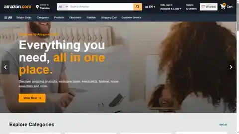

# 🛒 Amazon-Inspired E-Commerce Website

A frontend e-commerce practice project inspired by common online-shopping experiences. It demonstrates product presentation, search interactions, shopping-cart behavior, and responsive page styling.

> This is an independent educational project and is not affiliated with, endorsed by, or sponsored by Amazon.

## 🌐 Live Demo

[Open the deployed website](https://amazon-clone-e-commerce-website.vercel.app)

## ✨ Features

- E-commerce-style homepage
- Product browsing and category sections
- Product search interface
- Add-to-cart interactions
- Cart quantity and price updates
- Responsive layout
- Interactive JavaScript elements
- Back-to-top navigation

## 🧰 Tech Stack

- HTML5
- CSS3
- JavaScript
- Font Awesome
- Google Fonts

## 📸 Website Preview



## 📁 Project Structure

```text
-Amazon-Clone-E-Commerce-Website/
├── screenshots/
│   └── amazon-clone-home.webp
└── README.md
```

## ▶️ Run Locally

1. Clone the repository:

   ```bash
   git clone https://github.com/syedanoorfatima/-Amazon-Clone-E-Commerce-Website.git
   ```

2. Open the project folder.
3. Open `index.html` in your browser, or run it through a local development server.

## 🎯 Learning Goals

This project helped practice responsive frontend development, DOM manipulation, JavaScript event handling, product search, and shopping-cart logic.

## 👩‍💻 Author

**Syeda Noor Fatima**

[GitHub](https://github.com/syedanoorfatima) · [LinkedIn](https://www.linkedin.com/in/syeda-noor-fatima-webdeveloper)

---

If you find this project useful, consider giving the repository a ⭐.
